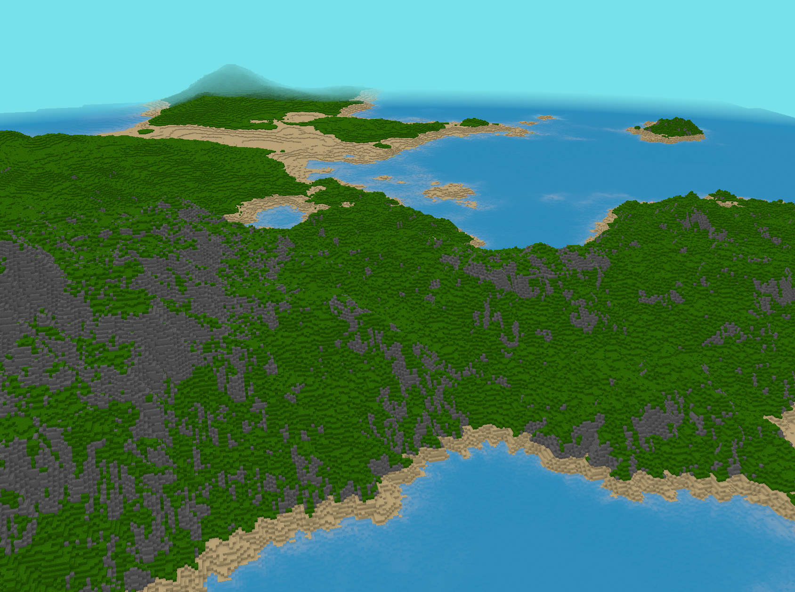

# rustcraft

Another Minecraft clone, originally written using [specs](https://github.com/amethyst/specs) and [glium](https://github.com/glium/glium) but recently migrated to Bevy.

```
cargo run --release
```



## Controls

- WASD to move, Shift to sprint, mouse to look.
- Space to jump, or to swim up in water.
- You start flying: Space and Ctrl move up and down, and you pass through blocks. F switches to walking and back.
- `[` and `]` move the sun, and F1 shows the debug overlay.

## Planned work

- Breaking and placing blocks.
- Saving the world.

## License

Licensed under either of

- Apache License, Version 2.0
  ([LICENSE-APACHE](LICENSE-APACHE) or http://www.apache.org/licenses/LICENSE-2.0)
- MIT license
  ([LICENSE-MIT](LICENSE-MIT) or http://opensource.org/licenses/MIT)

at your option.

## Contribution

All contributions are welcome. Feel free to open issues for fixes or discussing changes.

Unless you explicitly state otherwise, any contribution intentionally submitted
for inclusion in the work by you, as defined in the Apache-2.0 license, shall be
dual licensed as above, without any additional terms or conditions.
